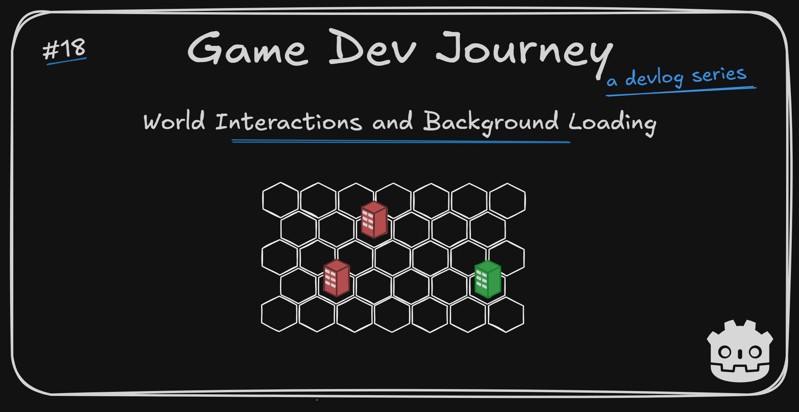
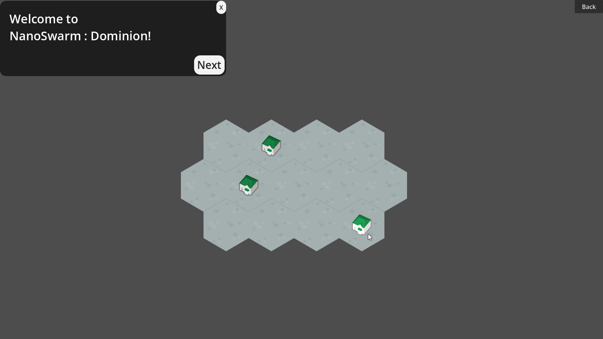

# World Interactions and Background Loading

Greetings, fellow traveler. Bored of waiting for your Resources to load ? Maybe just wanna know how to add markers to your own map ? 

Wait no longer! In this week's blog post, I quickly bring you up to speed on the latest additions to the OverWorld map, how I implemented loading in and out of each City and how I *didn't* wait for those loadings to happen, thanks to Godot's `ResourceLoader`. 

## This week's highlights

Most of the focus this week was aimed at adding some of the *core* behaviors to the OverWorld map.

The first one was the ability to dynamically add little "City PoI" (Point of Interest) to the map based on some data (read: static sample of yet another Godot `Resource`) prepared before hand. At this stage in development, this was very straightforward since all principles needed to do that I have already practiced them when first implementing my City scene. 

It looks something like this :

> Care to give a quick refresher ? 

Sure. A simple combination of a custom `Resource` that contains a `Vector2i` property to hold it's "grid position", one step in the map's instantiation that created one new custom `Node2D` for visuals for each data instance and, when setting the node's position, just translate it to "real world coordinates" using `map_to_local` method.

One noteworthy aspect : For each "PoI" I was able to reuse an existing `Resource` in the project to represent the City - the same one I use as a "starter" to generate a City's layout instructions. So there is a clear and logical "connection" between the concepts. 
- Each "City PoI" holds the city's base information
- When the player chooses to navigate to a new city, this information is retrieved
- For the selected City's information, instructions are generated to then create a new City layout!

> Noted. Sounds pretty neat!

Thought so too!

With this simple "points-of-interest placement" section taken of, I then created what I thought at the time to be a quick "wrapper" for both the OverWorld and the City scenes. It's original goal was to have a "base" scene, always loaded up, to manage the transitions to and from a specific City.

> Okay ... And what went wrong ?

Oh, nothing! It's now doing that and a bit *more*.

Not only I can load into and out of both scenes, I can do so while I look at a loading bar! Not the prettiest loading bar, but it *moves*.

> Ooh? Tell me how!

So, I have not built a "complete component" by any measure, but this behavior can be achieved by using Godot's `ResourceLoader` class and it's thread-related methods, with [`load_threaded_request`](https://docs.godotengine.org/en/stable/classes/class_resourceloader.html#class-resourceloader-method-load-threaded-request) and [`load_threaded_get`](https://docs.godotengine.org/en/stable/classes/class_resourceloader.html#class-resourceloader-method-load-threaded-get) being the main two.

The main loop is not hard to grasp :
- When we want to *start* loading a new `Resource`, we use `load_threaded_request`
- Every so often (which means, on the `_process` method) we check if it's loaded using `load_threaded_get_status`
- Once it's loaded, we retrieve it with `load_threaded_get` and do the rest of our logic

To add a "loading screen" on top of this, we just have to create any custom `Scene` of our liking and toggle it on/off when we start/stop a given `Resource` loading. For the progress bar, the `load_threaded_get_status` also let's us retrieve a load percentage, so that's also taken care of.

Oh, and if you - yes, you the reader - want a more "detailed" explanation, just let me know! Once I finish up this particular implementation, I would be more than happy to share with those who are curious!

Here's a quick glance of all this in action :

## Plans for next week

Even thought it *seems* I got a lot done this week, it didn't quite hit the mark for me. Most of the City's dependencies are not prepared to being loaded in background, so that's what I'll be tackling next. Apart from that, there is this idea of "fog of war" that I thought of adding to the OverWorld map, so I'll be trying that too!

Hope this blog post was helpful in any way.  
Got a question or just wanna discuss something? Feel free to reach out!  
And thank you for reading!