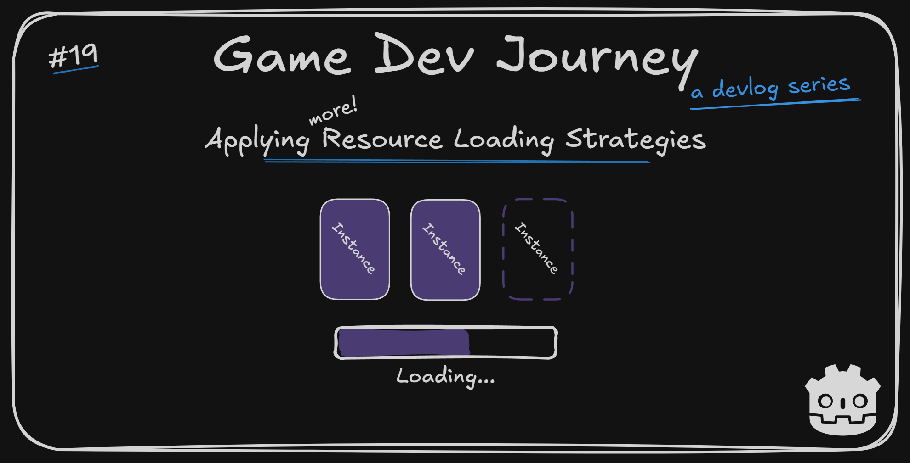

# Applying Resource Loading Strategies in Godot

Greetings, fellow traveler. Are you familiar with the different types of loading ? *Background* loading, *Lazy* loading, *Eager* loading ... Not all of them ?

Don't worry! In this week's blog post, I will be highlighting the most common strategies to improve loading times (and resource usage) and how to apply them to a game project (or any project).

## This week's highlights

Being able to load any element we need for our game, when we need it, is great! But once we start to handle more than four or five components, each with different use cases in mind, it can reflect in our experience with bigger (or frequent!) load times on each player interaction. 

With that in mind, I am trying to tackle the subject *early* in my project development. 

> Didn't you solve that last week ? By loading Scenes in background ?

I *started* solving this matter last week, correct. But that was only part of the solution.

By using Godot's `ResourceLoader.load_threaded_request` and `ResourceLoader.load_threaded_get` properly we can achieve what's called **Background Loading** - being able to load things in one (background) thread, while we are showing something else to the user/player. Usually a loading screen.

There are other strategies we can use to our advantage - which I did, this week.

For my city layout generation, for example, simply loading the whole component in background at once was not giving good enough results because the screen would stay "still" during the whole process. I was able to improve it's "perceived" load times by splitting the whole logic into smaller, sequential, chunks and I run them one-by-one, updating the user (by updating the progress bar) as I go.

> Running "chunks" of logic ?

That probably sounded harder than it is. In a nutshell, we take our *one* big generation method and split it into a few smaller methods. Then we can run them in order, using an auxiliary `status` property to help keeping track. And then we invoke them every few ticks in the `_process` method. 

> And every few ticks, the progress bar increases and we see progress!

Exactly. User (or in this context, player) feedback is important, sometimes more than actually making logic run a few seconds faster.

Alongside this approach, there are two more I "sprinkled" on my project this week: **Eager loading** and **Lazy loading** :
- On one hand, we can choose to load some resources *earlier* than necessary, so the user only has to experience "one" load at the beginning instead of multiple load periods, interrupting the game flow.
- On the other hand, we can decide to load some resources as *late* as possible, to ensure we only put in memory only the necessary data when we need it.

> But won't those two conflict with each other ?

Well, we won't be using the two approaches on the same exact component at the same time. And you have probably used one of these strategies already, without knowing it. Know you will be using a particular asset multiple times ? Load at once on start up, use it when you need it. There's a chance that sometimes the player goes to a particular zone or level ? Only load those resources when he interacts with it.

On my project, both in the City and the OverWorld, I moved some dependencies loading I knew I would be needing - no matter what - to the same time I load the base Scenes themselves by using `preload` on a variable. So, when I start instancing a OverWorld scene, I also start loading up the Points-of-Interest scene too!

And for my City generation `Resources` (my blueprints), I only need those when I am generating a "new" layout. Not when I am loading one from file. So I changed the "moment" when I load them up from a Singleton's instantiation to a specific method, invoked only when I start generating a new city. I even paired that one with the `ResourceLoader` thread methods to load most of them in background threads, so these methods can (and should!) be combined.

In case you're curious on how this all looks in practice, here's a quick showcase video :



As per usual, any specific questions about how to use this specific approaches, just ask away!

## Plans for next week

I still have the "fog of war" idea to explore and implement, so next week I will be focusing on that one, alongside some smaller improvements in the PoI icons ( different icons or tint to separate conquered cities from the other ones) and general code cleanup.

Once that's done, I have to decide which aspect to tackle next. And there are a few interesting options...

Hope this blog post was helpful in any way.  
Got a question or just wanna discuss something? Feel free to reach out!  
And thank you for reading!