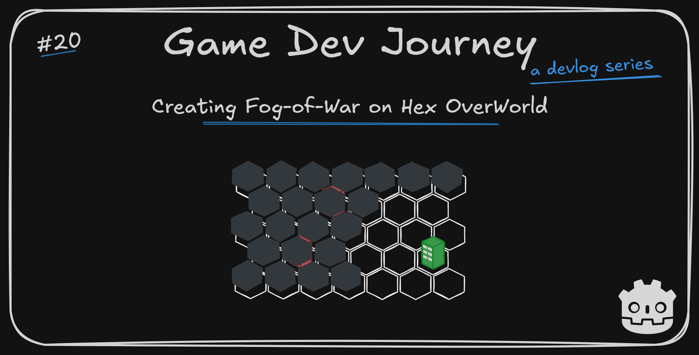
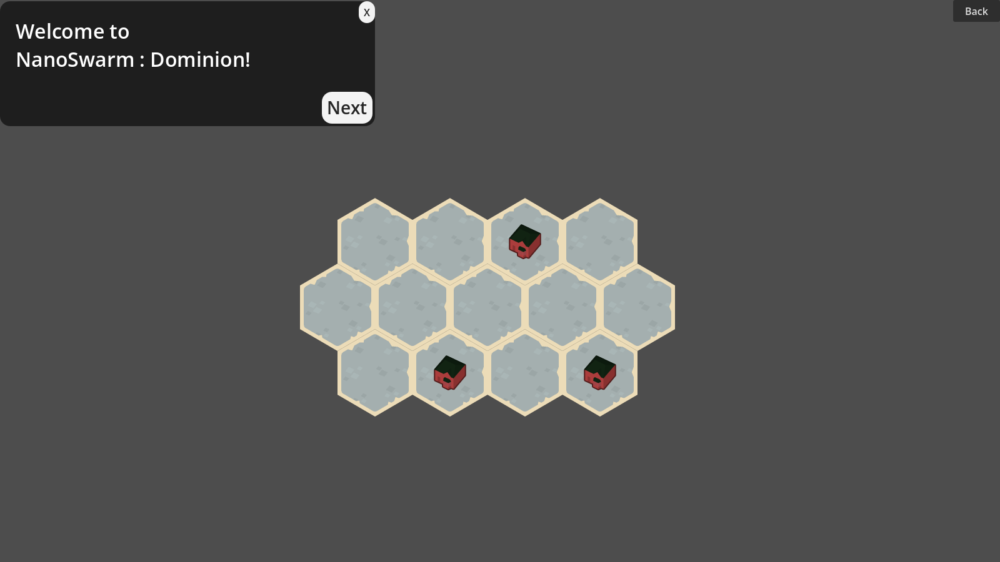
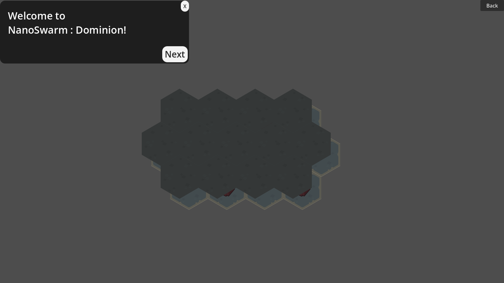
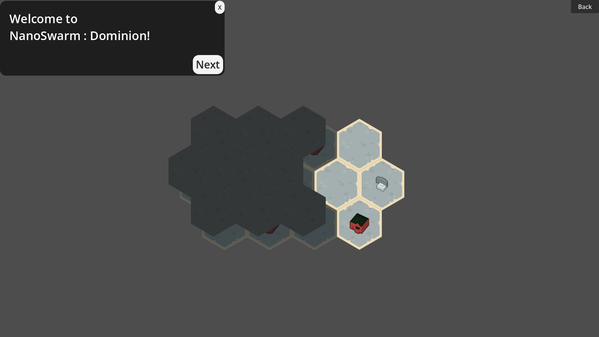
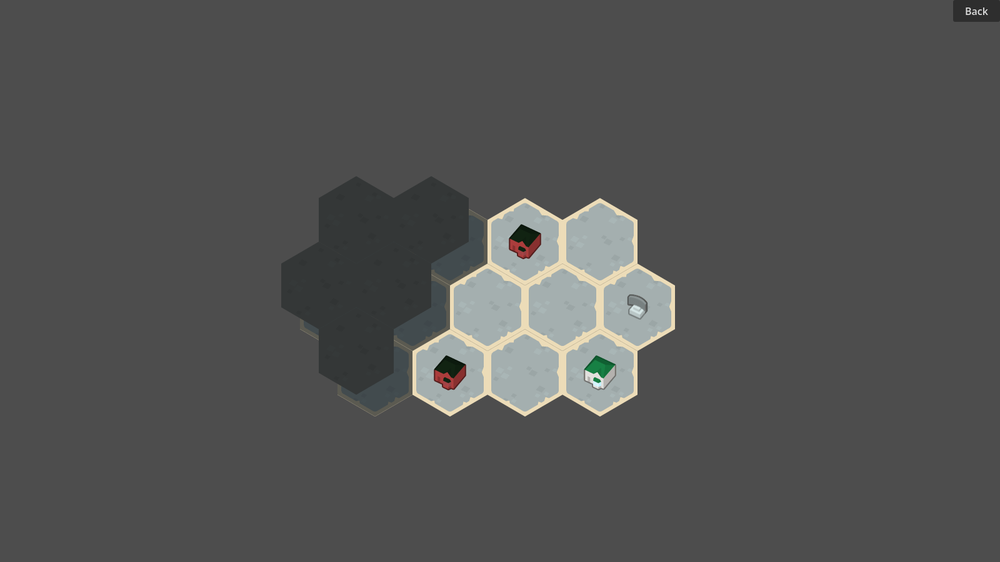

# Creating Fog-of-War on Hex OverWorld in Godot

Greetings, fellow traveler. Thinking on how you could add fog-of-war to your own game ? Something to make the player think which way to explore first ? 

Then welcome in! In this week's blog post I write about the concept of fog-of-war and how I managed to implement something simple using mostly simple Godot elements to do it.

## This week's highlights

At the start of this week, my game's OverWorld map looked something like this :

A simple map, with three interactive icons to enter in the respective City Level. And yes, I changed the ground tiles and tinted the icons since last week, for readability reasons.

With this as a starting point, my goal for this week was to implement a basic "fog-of-war" system. Nothing out of the ordinary, just some dark-ish clouds (which I didn't have, so I used `modulate` to change the color of some ground tiles.) that can be placed in some tiles to hide parts of the map.

Probably the first question is...

> But why adding fog-of-war ?

...that one, yes. There's a few common reasons I can think of as to adding this mechanic to a game. It could be a 4X game, where the player needs to explore and risk units to try and find precious resources (or other players). Or it's a survival game and exploration is half of the fun!

In *my* case, here are the reasons that brought the idea up:
- Mechanics-wise, I needed something to limit the player choices as to which cities could be attempted, to prevent someone trying to rush past all levels and loose against the hardest one, to then blame the game for bad mechanics
- Theme-wise, the idea of slowly but surely uncovering the map as you conquer more and more cities sounded nice
- And ... after the idea crossed my mind, I just wanted to see if I could do it

Luckily, implementing a basic version in Godot was not that hard!

> You always say that! Not fair.

And it's the truth... usually, at least. Sometimes I take more time with the visual elements than I'd like, but the rest is always achievable. Or I would not be writing this blog posts, would I ?

Speaking of visual elements, here's one! The same map, covered in fog:

I used **two** new `TileMapLayers` to complete the effect. 
- One directly on top of the "ground" layer, mirroring the placed tiles with an added `Shader` that darkens the final result. This gave me the "shadow" portion
- One on top of the "ground" layer, but slightly skewed to the top-left side so we can have a sneak peak of what's under need. In this one I place my "totally-cloud" tiles, giving me the "fog" portion

After that, I needed something to "clear" the fog around the beginning area. I *could* just remove the fog in those tiles, but that wouldn't make any sense. So I created a "MiscPoI" (point-of-interest) element that can act as a "radar" for our swarm, clearing a 1-hex radius worth of tiles. It looks more or less like this :

Now the player can see the first City level to start the run, and I have a reusable element in case I want to clear more fog arbitrarily.

Also, quick note. Turns out, doing math for measuring distances in hex maps is different, somehow. So, if you are also thinking in adding a hex map to your game, you might want to read up on that too! [This link](https://www.redblobgames.com/grids/hexagons/) may be a good place to start. Maybe.

Now that the player can see the first City, there was only one thing left. After conquering it, clear more of the map! Using the same exact logic as the "radar" from before, but with a 2-hex radius this time, we get see our map more clearly :

In this scenario, now would be up to the player to choose which City to conquer first. Maybe the one with the better rewards, or the one that's less defended.

> Ah, so that's why you tinted the City icons. To distinguish between Enemy and Conquered ones.

Glad you noticed! Ideally I would have the same "model" in multiple colors, but I do not. So I have to be creative, sometimes.

Alongside all this, there were a few details that I was implementing in parallel to all this, like disabling the on-hover and click effects of a point-of-interest while it's under fog-of-war.

Even if it's not that attractive, I'm still happy with the result.

## Plans for next week

In my mind, it makes sense to continue a bit longer with the improvements on the OverWorld portion of the game. The next one I have in mind is "level info cards". Small cards that, when the player clicks on a City marker, show the level information *before* the player enters. Seems to be the next logical step. Oh, and I want to try and add those cool "zoom in" effects that some games have. That could be fun.

Hope this blog post was helpful in any way.  
Got a question or just wanna discuss something? Feel free to reach out!  
And thank you for reading!