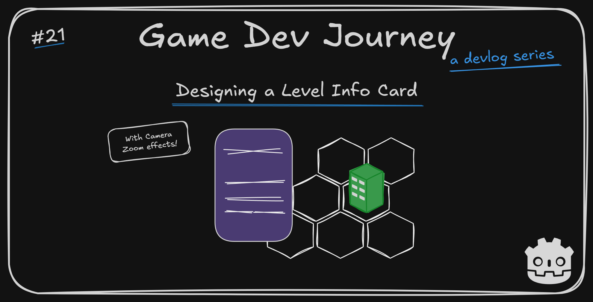
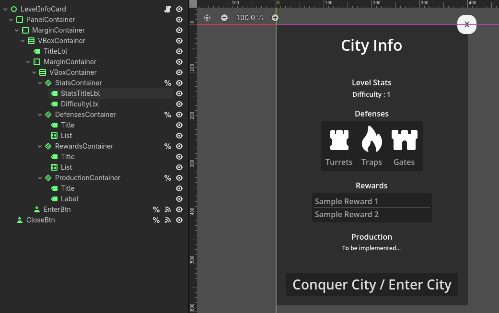

# Designing a Level Info Card in Godot

Greetings, fellow traveler. Looking for ideas on how to present a level's info in your game ? Perhaps a preview screen before the player enters ?

Look no further! In this week's blog post I will be presenting two new improvements to my game's OverWorld map : A new card-like UI element with a City Level preview info paired with zoom in-and-out effects *without* affecting HUD elements.

## This week's highlights

It's been a slightly chaotic week. On one hand, I was able to work on the two things I planned last week (which is great!). On the other, it was not as productive as it could've been (sickness and other unpredictable events). So, don't expect anything "polished" in this blog post. I *do* like the final result, that's something!

Now, I like both things I did this week. Which one should I talk about first...

> Maybe the Level Card ? The one that's on the cover image that made me click here ?

Not a bad reasoning. Alright!

The focus of this week was an element I am calling "Level Info Card". A `Control` (UI) component that's in charge of showing a given City's info before entering it. In other words, it's *representing* the City's **data** in a pretty format to the player.

If you've been following along with my updates, this pattern should be familiar already. I created a new Godot `Scene` with various `Control` nodes - `VBoxContainers` and `MarginContainers` as the base frame, `Labels` and `Buttons` for the interactive elements and (first time trying it!) `ItemLists` for the collections of similar info (think : stats or reward lists). Then attach a custom script that allows us to receive our "data" from the outside (in my case, the same "CityLevelInfo" I've been using) and update the needed visuals.

As per usual, I've gone with a simple structure (Mainly because I'm not good with UI). It looks something like this :

For the icons, I have once again recurred to some of [Kenney's Icons](https://kenney.nl/assets/board-game-icons). Not a perfect fit for what I had in my mind, but the icons are pretty regardless. 

For the logic behind it, it's nothing more than a public method to store and set properties like `Label.text` and similar. No fancy tricks (yet).

> I for one like the icons! And the final result as well!

Why thank you, imaginary voice!

Now, for the last piece of this puzzle : The zoom-in effect! I took inspiration in some of the games I like to play - Like "For The King" and "Against the Storm" - for this one. I wanted for the player to **focus** on the City once selected. And reading a info card while glancing at a far-away icon is not that great. 

To achieve that, I added a new element to my OverWorld `Scene` called `Camera2D` which allows us to change at what part of the `Scene` the player is able to look at And yes, it allows us to zoom in and out as we see fit! There's just one small "issue".

> Issue ? How bad is this one ? 

It's one of those "unexpected, but logical" ones. When I tested out the `Camera2D` zoom in feature, it did in fact zoom in *everything*. Including the `Control` HUD elements I created that I *did not* wanted to be affected. 

Luckily, I found a solution that worked right out of the box. By moving all my HUD elements under a new node - a `CanvasLayer` node - I was able to keep the layout exactly as it was, while isolating this nodes from the `Camera2D` effects.

As for the zoom in-and-out effect, I will let you try to think on your own solution for it.

[Sample Zoom in](Devlog_21/zoom_in.gd)

> Really ? Not even a clue ?

I can do that! You will want to keep track of two types of positions - one for when you want to zoom *in* and one for when you want to zoom *out* - as well as the actual zoom values (1x, 2x, etc). Bonus points if you use Godot's `Tween` to smooth out the actual movement. If you end up needing a working example, just ask! 

After I integrated everything together, this is the final result :



## Plans for next week

Now that I got a proper way of showing the player a level's info before entering, I think it's a great moment to focus on other sections. For one, now that I can show what are the rewards for conquering a City, it would make sense if the player could actually *receive* said rewards, right ? So, a "rewards screen" is in order. As well as a few other HUD elements.

I am also purposely saving two of the most important elements of the game for "later" in development, so I can have dedicate a whole time block to them and obsess over all the details I want. Something to look for!

Hope this blog post was helpful in any way.  
Got a question or just wanna discuss something? Feel free to reach out!  
And thank you for reading!