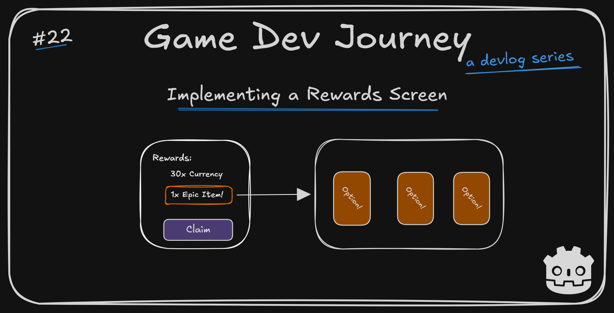
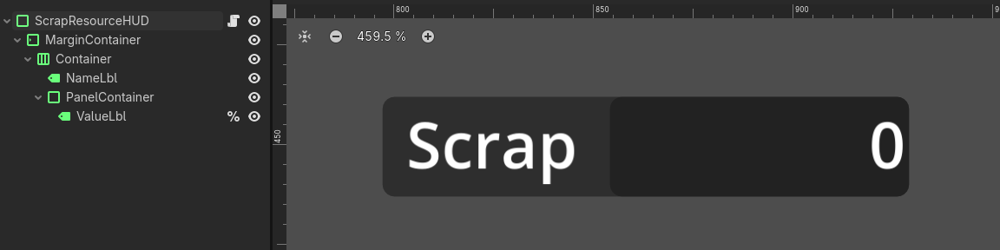
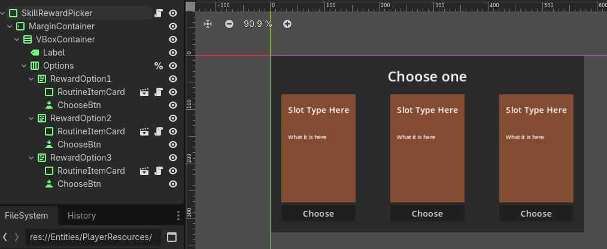

# Implementing a Rewards Screen in Godot

Greetings, fellow traveler. Are you perhaps searching for a way to keep your players engaged with your own game ? Maybe something *shiny* after completing a level ?

The answer is **Rewards**! In this week's blog post I'll be writing a bit about rewards and how they look like in my game. At least, this initial version of it.

## This week's highlights

Remember when last week I commented on it being a chaotic week ? Well, this one was not any calmer.

> Oh no! So you were not able to finish the planned things ?

On the contrary, funny enough! I somehow managed to power through and do what I originally had thought of for *two* weeks.

During this time, I was able to introduce two new concepts into the project :
- **Rewards** : After conquering a new city, the player receives things such as "Triggers", "Actions" or other *resources*
- **Scrap** : The first player *resource* in the game! Think of it as a simple currency

None of these concepts are new, and neither are the elements I have used to implement them. This is just my version of it's implementation.

Let me start with the smallest of the two - The "Scrap" resource.

At the time of writing, I am envisioning "Scrap" to be the main expendable resource. There will be multiple ways of earning it, as well as spending it. For now, it will be a simple integer value that I'll keep track of whenever I start a run. And, to do that, I will be wrapping it in it's own custom `Resource`.

> Is that really necessary ?

Probably not. Especially at this stage in the project. But it makes sense to me to do it in this way. It is also a great place to add a `signal` to notify other components when the stored amount changes. Components like a tiny "HUD" element that displays the updated value, for example.

Only real "trick" there is to ensure that only one instance of this `Resource` is created during the run. All other components should get a *reference* to it.

For the `Resource` itself, it's a pretty simple file with a "value" property plus the mentioned `signal`. Something like this :

[Scrap Resource](Devlog_22/scrap_resource.gd)

As for the HUD component, I have create a simple "pair" of name and value labels. Like so :

And, to have it stay updated wherever I decide to place it (in the OverWorld, inside a City, etc), I attached to it this snippet : 

[Scrap HUD code](Devlog_22/scrap_hud.gd)

> I do appreciate the simple things

Now, as for the "Rewards"... 

Each City (read : Level) in my game has it's own set of rewards that can be received (for now, a static list. In the future, randomly populated). It can be seen in the "Level Info Card" I have created, and can be seen once again on victory.

So, as per usual, I've created new UI elements to represent the rewards visually and I have created new data classes to hold the information of each reward.

To get this to work as I wanted to, it took *some* code. Mostly wiring events from one end to the other and interacting with pre-existing elements in my game.

Here's the quick rundown:
- Created a new "Rewards" custom `Resource` which, among other properties, have a "type"
- Cities now can have a collection of "Rewards"
- After conquering a City, the Combat Results screen now shows the reward list
- When clicking on a reward, depending on it's type, either I increment the "Scrap" amount *or* show a popup with suitable options to choose from.

For the "reward list", I am using Godot's `ItemList` node - the same one from the "Level Info Card"! - to both show the reward options and handle the "on click" events. 

When the player clicks on a "scrap"-type reward, I simply add the respective amount to the global `Resource` tracker. When the player clicks on a "trigger"-type reward or a "action"-type reward, I then show them a "Skill picker" (think on the common "pick 1 of 3 cards" screen from roguelikes) with some curated options. Upon choosing one, I add it to the player's pool of options and close this screen. Which, by the way, looks something like this :

By putting everything together, I ended up with the following result!



## Plans for next week

Now that I have introduced the main resource in the game - "Scrap" - and a way for the player to gain it - through victory rewards - I think it's a good time to focus on ways to *use* it.

Will be looking into ways for the player to spend "Scrap" both in the OverWorld and while visiting a City. And this time it might take me way more than a week to get something working properly. Let's see!

Hope this blog post was helpful in any way.  
Got a question or just wanna discuss something? Feel free to reach out!  
And thank you for reading!