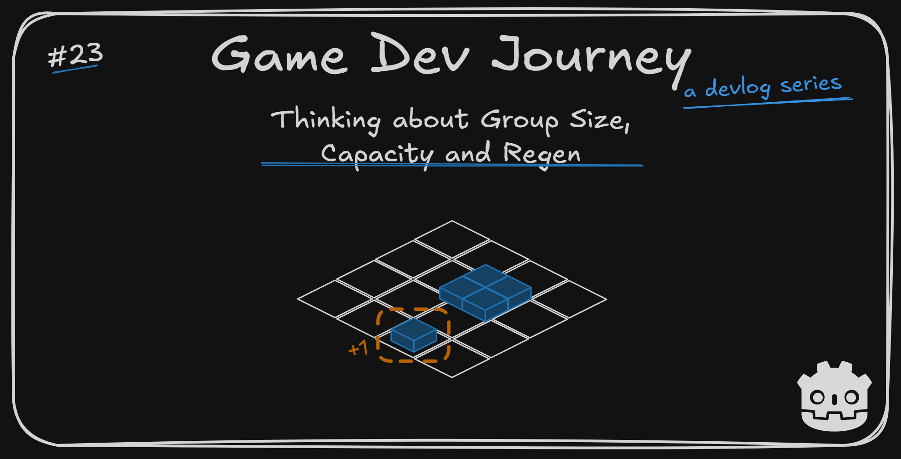

# Thinking about Group Size, Capacity and Regen

Greetings, fellow traveler. Care to join me for a brief moment to think about a unit group total capacity, and how to recover in between levels ?

Glad you could make it! In this week's short blog post, I will quickly mention the changes to the swarm's size implementation as well as talk about an idea for the first OverWorld action : Regen!

## This week's highlights

As I have pointed out in the briefing above, there is not that much content to go through today. Nevertheless, I'll write the changes regardless.

Up until this point, I have been spawning the same amount of units on *any* level, regardless of previous outcomes. All I had was one basic method that returned the `integer` "4".

> Wait, four ? As in ...

**Not** inspired by the private key issue a few weeks ago. Totally a coincidence. 

While I was prototyping the first few elements, I left the whole "swarm management" section for a later period. But now, motivated by a few changes I want to do elsewhere, I went back to improve this one aspect. So now ... There is a fancy new custom `Resource` for all swarm-related data, with two *very impressive* `integers` named "size" (current amount of units) and "capacity" (max amount of units).

> That's ... not that impressive.

Fair point. But this *not that impressive* `Resource` allowed me to do things like :
- Keep the current amount of units up-to-date. Even between levels
- Have an unique place to store and retrieve this kind of info
- Test out a new reward type that increases swarm capacity

> Alright, I'll bite. That allows for all these changes ?

Yes, yes it does. Even went ahead and removed some old code while I was cruising by (*tip : the small "derpy" squares are less "derpy" now*)

The first two points are pretty straight-forward : Create a single instance of the `Resource`, pass around a reference to it to places like the event that is emitted when a swarm unit is destroyed (HP reaches 0).

> And the reward type ?

That one is an idea I had recently. As this game is (or, will be) a "roguelike", one of the upgrades that should be available to the player is the swarm capacity. More units = better, right ?

What I don't have set in stone is *how* that upgrade will be available. In-between runs meta-progression ? In-run unlocks ? Both ? I see good points (and counter points) for all of these.

And then it hit me : What if the *main* way of increasing the swarm size was conquering *more* cities ? The more conquered (and functional) cities the player has, the more "computer power" (or another in-lore reason to justify this) the player has access to. So, more units.

> Might be interesting, yes ... Wait, functional cities ? What does that mean ?

Once I implement that one, I'll explain it. Pretend you didn't read that.

It's only an idea. May stay forever and be one of the core things. May be removed in a week or two because it's silly. Will let future me answer that one too.

To try it out, the simplest idea I could think of was ... To reuse the reward system I created last week! All that's needed is to create one more reward type, have it show up when I want to and, on redeem, increase the swarm's capacity (not size).

## Plans for next week

Since this week was low on changes, the plan is mainly unchanged. The focus will be on ways for the player to spend "Scrap". The first one I came up with is : the option to "regen" / craft new swarm units using "Scrap", while in the OverWorld.

We will see how that idea goes too.

Hope this blog post was helpful in any way.  
Got a question or just wanna discuss something? Feel free to reach out!  
And thank you for reading!